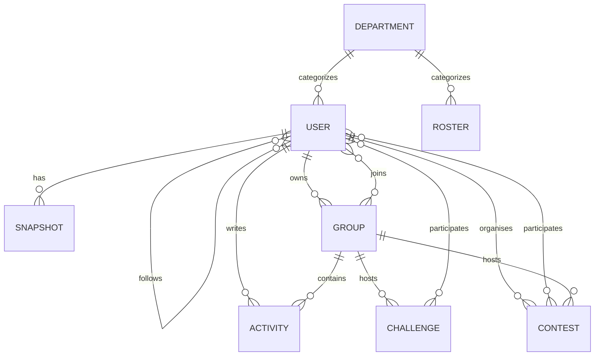

# Database design

MongoDB database `leettrack` with Mongoose schemas in `server/models.js`, extending Rankboard's original User schema.

| Collection | Main fields | Constraints |
|---|---|---|
| users | name, email, passwordHash/legacy password, googleId, authVersion, role, college, department, section, semester, bio, leetcode, leetcodeLinkedAt, verified, following/followers, goal (unused), visibility (college/groups/private), visibleGroups, stats, score | Unique email; partial unique (college, leetcode); sensitive credential fields excluded by default |
| snapshots | user, date, handle, total/easy/medium/hard, rating, rank, percentile | Unique (user, UTC date); indexed user reference |
| groups | college, name, description, color, owner, members, inviteCode | Unique invitation code; owner included in members; max 100 members |
| challenges | college, creator, group or null, title, description, metric, target, startsAt, endsAt, participants | Participant stores user, baseline, joinedAt and optional frozen finalValue |
| contests | college, organiser, group or null, inviteCode, title, description, startsAt, endsAt, penalty, problems (slug, title, difficulty, premium, points), participants, checkedAt, finalized | Unique invitation code. Each participant stores joinedAt, checkedAt, checkError, every in-window submission seen on LeetCode (slug, timestamp, status, language) and shared solutions |
| activities | college, user, group or null, type (message, milestone, rank, contest; legacy sync rows are hidden), text | Private events require group membership; following feed selects only group=null |
| departments | college, code, name, sections | Unique (college, code); at least one department is retained |
| rosters | college, name, email, department, section, semester, leetcode | Unique (college, email); does not create login credentials or affect rankings |
| sessions | session JSON, expiry | connect-mongo TTL; rotated on login/password change, revoked on logout |

`stats` embeds real LeetCode totals, rating, global ranking, attended contest count, UTC calendar map, contest history, recent accepted submissions, syncedAt and syncError. This allows one read to render the profile. Daily snapshots retain comparable historical values independently.

College identity is server-controlled (`campus` for this installation). Administrators and student users cannot choose a different college through a request body. The installation's display name is configured by `COLLEGE_NAME`.

Academic fields are optional legacy metadata. New accounts receive no default department, section or semester, and these fields are absent from the current student/admin UI. Legacy API references use department/section codes. Management routes check references before removing a department or section. Student deletion removes snapshots, activity, social links, group membership, challenge and contest participation, and contests they organised. A student owning a group must delete it first. Group deletion removes its challenges and messages; its contests remain, reachable by invitation code.

Current-day snapshots are updated after synchronization; prior dates are not rewritten. A LeetCode handle is required for password signup and profile completion. Google identities may temporarily have no handle, but protected app APIs return HTTP 428 until linking is complete. `leetcodeLinkedAt` records an explicit selection; legacy `unknown` records without it require linking again and are excluded from rankings and automatic sync. Changing a handle clears that user's history to prevent comparisons between different accounts. Percentiles use linked registered students, including users pending college verification; roster-only students are excluded.

The embedded development MongoDB uses persistent WiredTiger files. MongoDB Atlas or another managed MongoDB can be configured without changing models. No database transactions are assumed; import validation occurs before bulk writes, and standard unique indexes protect identities.
